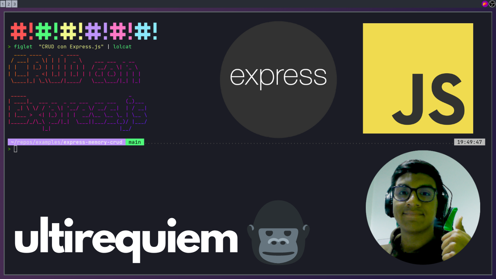

# Express CRUD Task API

> CRUD: CREATE, READ, UPDATE and DELETE

Express is a web framework for Node.js 🐢

[Live coding](https://youtu.be/mP2ZMpm8y3o) 👇

## Support

Open an Issue, I will check it as soon as possible 👀

If you want to hurry me up a bit
[send me a tweet](https://twitter.com/UltiRequiem) 😆

Don't forget to star the repo ⭐

## Licence

Licensed under the MIT License 📄
